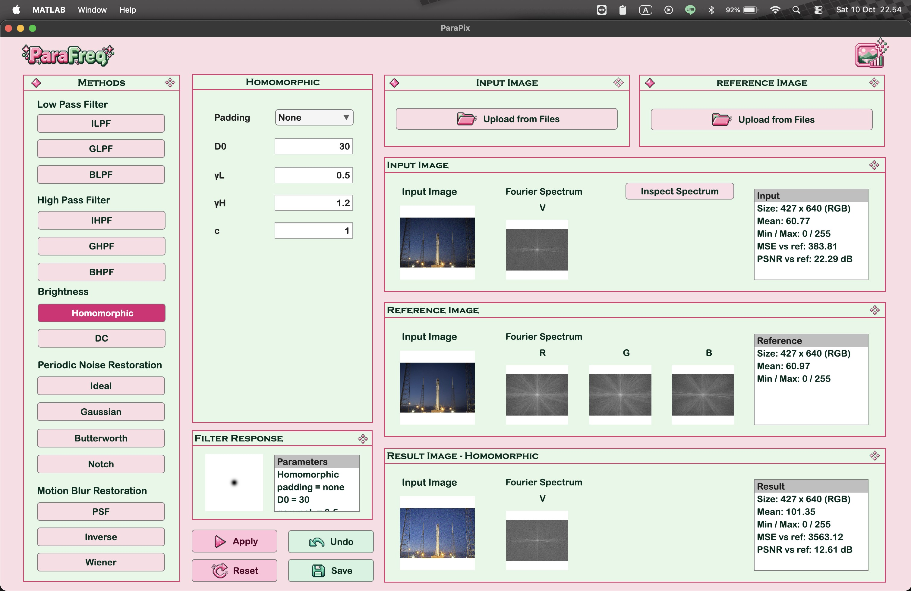

<div align="center">
    <h1>ParaFreq</h1>
    <p><em>A MATLAB frequency-domain image filtering and restoration app with hand-built transfer functions</em></p>
    <p>
        
        
    </p>
    
</div>

---

## Description

ParaFreq is a desktop image processing application built with MATLAB App Designer. It loads a grayscale or RGB image, processes it in the frequency domain, and shows the input, reference and result images together with their Fourier spectra, the filter or PSF used, and MSE/PSNR against a reference image. Every transfer function H(u,v), PSF and restoration filter is built by hand in `src/`. Only `fft2`, `ifft2`, `fftshift` and basic matrix operations are used from MATLAB.

---

## Features

**Low-pass filter (smoothing)**

| Method | Parameters |
| --- | --- |
| Ideal (ILPF) | Padding (none, zero, mirror), cutoff `D0` |
| Gaussian (GLPF) | Padding, spread `σ` |
| Butterworth (BLPF) | Padding, cutoff `D0`, order `n` |

**High-pass filter (sharpening)**

| Method | Parameters |
| --- | --- |
| Ideal (IHPF) | Padding, output mode (clip, normalize), cutoff `D0` |
| Gaussian (GHPF) | Padding, output mode, spread `σ` |
| Butterworth (BHPF) | Padding, cutoff `D0`, order `n` |

**Brightness in the frequency domain**

| Method | Parameters |
| --- | --- |
| Homomorphic | Padding, cutoff `D0`, `γL`, `γH`, sharpness `c` |
| DC | Gain `a`, offset `b` applied to the DC component |

**Periodic noise restoration**

| Method | Parameters |
| --- | --- |
| Ideal / Butterworth / Gaussian bandreject | Padding, ring radius `C0`, width `W` (and order `n` for Butterworth) |
| Notch reject | Padding, type (ideal, Butterworth, Gaussian), `D0`, order `n`, notch centres |

Notch centres can be found automatically with **Detect Spikes** (threshold `k`, DC radius `rDC`), typed in by hand, or picked by clicking spikes in **Inspect Spectrum**.

**Motion blur restoration**

| Method | Parameters |
| --- | --- |
| PSF | Length `L`, angle `θ` (simulates motion blur on the loaded image) |
| Inverse filtering | `L`, `θ`, mode (none, threshold `ε`, radius `R`) |
| Wiener filtering | `L`, `θ`, constant `K` |

`L` and `θ` are filled in automatically from file names such as `..._motion_L19_A20.png`.

---

## Project Structure

```
.
├── main.mlapp          # App Designer GUI
├── assets/             # app logo and button icons
├── src/
│   ├── pipeline/       # one entry point per part, called by the GUI
│   ├── fourier/        # padding, centred spectrum, inverse transform, distance grid
│   ├── lowpass/        # ILPF, GLPF, BLPF
│   ├── highpass/       # IHPF, GHPF, BHPF
│   ├── brightness/     # homomorphic filtering, DC manipulation
│   ├── periodic/       # bandreject filters, notch reject, spike detection
│   ├── motionblur/     # motion PSF, H(u,v), inverse and Wiener filters
│   ├── metrics/        # MSE, PSNR
│   └── utils/          # image loading, grayscale, display and output conversion
├── data/               # official test images
└── output/             # saved results
```

---

## Dependencies

- MATLAB R2026a or newer
- No additional toolbox is required

---

## How to Run

1. Clone the repository

   ```bash
   git clone https://github.com/carllix/IF4073_Tugas2_13523071_13523091.git
   cd IF4073_Tugas2_13523071_13523091
   ```

2. Open `main.mlapp` in MATLAB App Designer and press **Run**.

3. In the app:
   1. Click **Upload from Files** under the input panel and choose an image.
   2. Optionally upload a reference image to show MSE and PSNR.
   3. Pick a method and set its parameters.
   4. Click **Apply**. Use **Undo** or **Reset** to go back.
   5. Click **Save** to export the result, its spectra before and after, the filter or PSF, and the parameters used.

---

## Authors

<table>
  <tr>
    <td align="center">
      <a href="https://github.com/adndax">
        <br />
        <span><b>Adinda Putri</b></span><br/>
        <p>13523071 </p>
      </a>
    </td>
    <td align="center">
      <a href="https://github.com/carllix">
        <br />
        <span><b>Carlo Angkisan</b></span><br/>
        <p>13523091</p>
      </a>
    </td>
  </tr>
</table>
